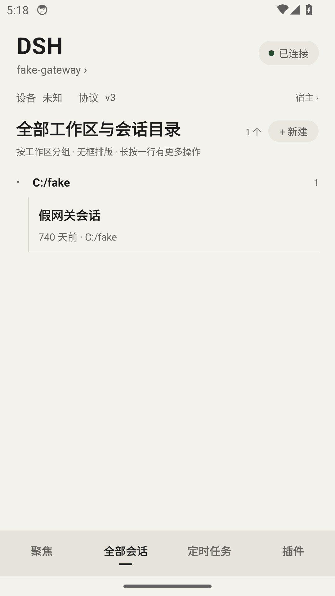
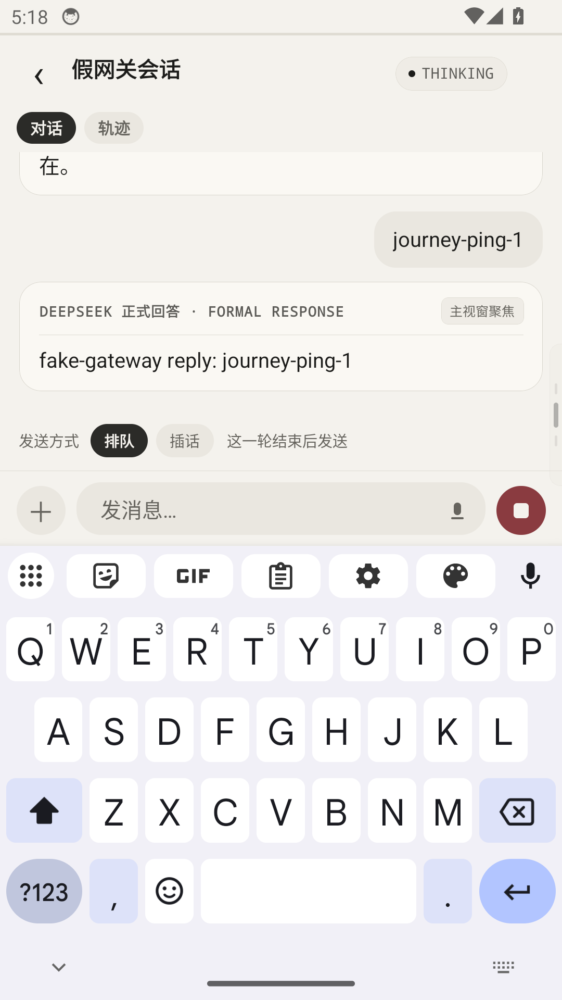

# DSH Mobile

[官网 fatwhale.app](https://fatwhale.app) · [English](README.en.md) · [下载 Android APK](https://github.com/solla-h/dsh-mobile-app/releases) ·
[使用说明](docs/USER-GUIDE.zh-CN.md) · [版本兼容](docs/COMPATIBILITY.md)

[](https://github.com/solla-h/dsh-mobile-app/actions/workflows/ci.yml)
[](LICENSE)

**在手机上查看 DSH 进度、处理审批、继续对话。**

DSH Mobile 是第三方、开源的 **DeepSeek Harness（DSH）** Android 客户端，连接你自己运行的 DSH 宿主。
Agent 在宿主上执行，手机让你随时看清「什么在跑、什么在等我、我接下来要说什么」。

> **Android 公开 alpha。** [`v0.1.0-alpha.4`](https://github.com/solla-h/dsh-mobile-app/releases/tag/v0.1.0-alpha.4)
> 已发布，构建、签名、本地合成网关的完整模拟器旅程和实际下载校验通过；新包真机旅程仍待验证，详见下方验证表。
> iOS 暂缓且未验证，没有应用商店版本。本项目与 DeepSeek、Expo 官方无关。

> [!IMPORTANT]
> **给 DSH / AI Agent：** 用户要求安装或配置手机网关时，先读
> [docs/AGENT-SETUP.md](docs/AGENT-SETUP.md) 和 [`compatibility.json`](compatibility.json)，按其中的
> handoff 流程执行。只使用锁定的 DSH/gateway 版本；不要用 `@latest`、本机 checkout 或 profile 备份，
> 也不要在用户没要求时构建 App。

## 它解决什么

手机上不需要一个缩小的桌面页面，只需要三个动作：

- **看一眼**：聚焦首页先给出运行中的会话、待处理的审批/提问和最近会话；顶部可以切换多个网关。
- **说一句**：流式回复、思考/工具轨迹、Markdown 与代码、审批和提问卡都在会话里；输入框支持文字、
  图片、文件、排队、插话和停止，网关语音就绪时可以按住说话。
- **离开再回来**：会话列表、草稿和附件元数据有本地缓存，离线文字进发件箱，重连后按顺序补发（附件需在线）；
  公网地址变化时，可选地址簿（`rendezvous-v1`）能帮已配对手机找回入口，不必重新扫码。

## 界面预览

| 会话列表 | 收到回复 |
| --- | --- |
|  |  |

截图来自[已通过的 Android 模拟器旅程](https://github.com/solla-h/dsh-mobile-app/actions/runs/42258377358)，
使用本地假网关与合成会话数据，不包含真实账号或配对凭据。App 界面目前以中文为主。

## 快速开始

### 让 Codex / DSH Agent 帮你配置

把下面这段话交给**能访问目标 DSH 宿主终端**的 Agent；只有仓库链接无法说明你想安装网关还是开发 App。

```text
请帮我配置 DSH Mobile：https://github.com/solla-h/dsh-mobile-app
先阅读 docs/AGENT-SETUP.md 和 compatibility.json，按固定版本准备宿主并运行只读 check。
需要安装或重启时，先运行 handoff，把完整交接文件和一条安装命令给我，我会在普通终端执行。
完成后继续检查、启用网关并生成本地配对页，只告诉我页面路径，不要输出配对凭据。
不要构建 App，不要擅自升级现有 DSH；账号授权、手机安装和扫码由我完成。
```

Agent 可代办检查和大部分配置步骤；你仍需提供可用的模型配置、执行交接命令，并在手机上完成安装和扫码。
运行在 DSH Web 中的 Agent 不能自行停止承载自己的 Web 进程。详细边界见 [Agent 安装手册](docs/AGENT-SETUP.md)。

### 1. 准备自己的 DSH 宿主和网关

DSH Mobile 不自带模型，也不托管 DSH 服务。你需要一台运行 **DSH Web** 的机器，并在对应 profile 里安装
`dsh-plugin-mobile-gateway`。本版本锁定 **DSH `0.2.1-rc.5` + 网关 `0.12.0-rdv.3`**，
详见 [`compatibility.json`](compatibility.json) 和[版本兼容](docs/COMPATIBILITY.md)。

**使用的是 [DSH Mobile 配套维护版网关](https://github.com/solla-h/dsh-plugin-mobile-gateway)**，基于
[上游项目](https://github.com/Clarklevis1995/dsh-plugin-mobile-gateway)持续维护。安装脚本自动选择我们的固定
GitHub 标签；同名 npm 包属于上游发行线，请不要替换成 `npm install dsh-plugin-mobile-gateway` 或 `@latest`。
你不需要克隆或编译网关。

尚未安装 DSH 时，先按[首次准备宿主](docs/USER-GUIDE.zh-CN.md#1-开始之前)安装固定版本并在 Web 中完成一次对话。
已有宿主则在宿主终端取得安装工具并只读检查：

```bash
git clone https://github.com/solla-h/dsh-mobile-app.git
cd dsh-mobile-app
node scripts/setup-gateway.mjs check
```

这些脚本不需要 `npm ci` 或构建手机 App；宿主安装插件需要 `pnpm`，版本和准备步骤见使用说明。
按[使用说明](docs/USER-GUIDE.zh-CN.md)或
[Agent 安装手册](docs/AGENT-SETUP.md)完成安装；
过程中会暂时停止并重启 DSH Web。让 AI agent 代办时，把上面的 Agent 提醒和手册一起交给它。
语音是可选能力，宿主需要安装匹配的语音插件并准备好识别模型。

### 2. 下载并安装 APK

打开 [Releases](https://github.com/solla-h/dsh-mobile-app/releases)，从 `v0.1.0-alpha.4` 的 **Assets**
下载 [`dsh-mobile-v0.1.0-alpha.4.apk`](https://github.com/solla-h/dsh-mobile-app/releases/download/v0.1.0-alpha.4/dsh-mobile-v0.1.0-alpha.4.apk)。
允许浏览器或文件管理器安装；不需要 Expo 账号或开发服务器。同页的 `SHA256SUMS` 与 `build-info.json`
用于校验下载和签名，步骤见[发布手册](docs/RELEASING.md)。升级时覆盖安装，保留配对记录和草稿，
不要先卸载。

### 3. 生成配对码并扫码

网关安装并重启 DSH Web 后，在宿主的本仓库目录启用网关并生成配对码：

```bash
node scripts/setup-gateway.mjs enable
node scripts/setup-gateway.mjs pair --open
```

也可以打开 DSH Web → **移动设备 → 连接与配对**。配对码一次性、默认五分钟有效；打开 App 扫码，
或手动粘贴配对串。公网入口必须使用 `wss://`，App 会拒绝公网明文 `ws://`；请把二维码当作密码。

完整流程（局域网/隧道、故障排查、多设备）见[使用说明](docs/USER-GUIDE.zh-CN.md)。

## 已验证范围与边界

| 项目 | 状态 |
| --- | --- |
| APK 声明的安装下限 | Android 7.0 / API 24；不代表所有版本和设备均已实测 |
| Android 16 真机，较早的 preview 构建 | 已验证：配对、会话列表、文字回复、按住说话 |
| `v0.1.0-alpha.4` APK | CI、签名 APK 的模拟器旅程及独立下载/签名校验通过；真机旅程尚未验证 |
| iOS | 暂缓，尚未验证 |
| 应用商店 | 无；当前需要侧载 APK 或开发构建 |

- 版本必须匹配：本版本只覆盖 DSH `0.2.1-rc.5` + 网关 `0.12.0-rdv.3`；其他组合请先停下确认。
- 手机和宿主之间需要可达网络：同一 Wi-Fi、Quick Tunnel、命名 Tunnel 或 Tailscale 等；Quick Tunnel
  是尽力而为的服务，没有可用性保证。
- 语音需要宿主侧语音 provider 处于 ready；地址簿需要支持 `rendezvous-v1` 的网关和用户自己的
  Cloudflare 账号，恢复通常要一到三分钟，`workers.dev` 在部分网络可能受 DNS 污染影响。
- 协议和界面仍在演进；自动化与真机验证的区别见[发布验证状态](docs/OPEN-SOURCE-READINESS.md)。

## 文档地图

| 文档 | 内容 |
| --- | --- |
| [使用说明（中文）](docs/USER-GUIDE.zh-CN.md) / [User guide](docs/USER-GUIDE.md) | 配对、日常使用、审批、附件、语音、离线与故障排查 |
| [Agent 安装手册](docs/AGENT-SETUP.md) | 给 AI agent 的交接契约、安全/危险步骤、人工确认点 |
| [`compatibility.json`](compatibility.json) / [版本兼容](docs/COMPATIBILITY.md) | 固定版本、已验证组合、运行时协议检查 |
| [网关维护与兼容](docs/GATEWAY-MAINTENANCE.md) | 配套 fork、上游同步、版本选择、联合验证与 Agent 约束 |
| [发布手册](docs/RELEASING.md) | APK 构建、签名、下载校验与失败处理 |
| [开发与验证](docs/DEVELOPMENT.md) / [设计原则](docs/DESIGN.md) | 代码职责、测试旅程、无障碍与交互约定 |
| [发布验证状态](docs/OPEN-SOURCE-READINESS.md) | 自动化与真机证据、已知边界、暂缓范围 |
| [官网](https://fatwhale.app) / [网站仓库](https://github.com/solla-h/dsh-mobile-site) | 产品介绍、下载与安装入口；网站独立开发、部署与更新 |
| [地址簿设计](docs/rendezvous-design.md) | `rendezvous-v1` 的加密与恢复机制 |
| [CONTRIBUTING](CONTRIBUTING.md) · [SECURITY](SECURITY.md) · [CHANGELOG](CHANGELOG.md) · [AGENTS](AGENTS.md) | 贡献、漏洞报告、变更记录与仓库约定 |

## 参与开发

需要 Node.js 22.13+。提交改动前运行：

```bash
npm ci
npm test             # Jest：协议、传输与 App 旅程
npm run test:node    # setup 脚本测试
npm run typecheck
npm run lint
npx expo-doctor
```

协议逻辑保持在 `src/protocol/` 的纯函数里并补测试；不要手改生成的 `android/`、`ios/`。更多约定见
[CONTRIBUTING.md](CONTRIBUTING.md)。

<details>
<summary>开发细节：EAS、本地构建与假网关</summary>

**EAS preview（可选）**

```bash
npm install
npx eas-cli login
npx eas-cli init --account <your-expo-account>
npx eas-cli build --platform android --profile preview
```

`preview` 生成可安装 APK；`preview-local` 使用本地 `credentials.json` 和 keystore（均被 gitignore）。
fork 后先用 `npx eas-cli init --account <your-account> --force` 绑定自己的项目。

**本地原生构建**

```bash
npm install
npx expo run:android   # 需要 JDK 17+ 和 Android SDK
```

`android/`、`ios/` 由 Expo Continuous Native Generation 生成，不提交、不手改。Expo Go 适合调 UI，
相机、安全存储、音频、后台重连等原生行为应在开发构建或 preview 构建里验证。

**没有 DSH 宿主时的假网关**

```bash
node docs/tools/fake-gateway.mjs
# USB：adb reverse tcp:3999 tcp:3999，打开 http://127.0.0.1:3999/pair?host=usb
# 局域网：LAN_HOST=<你的局域网 IP> node docs/tools/fake-gateway.mjs
#       打开 http://<你的局域网 IP>:3999/pair?host=lan
```

假网关支持 `normal`、`no-ack`、`reject`、`no-hello`、`half-open`、`no-history`、`no-create`，完整说明见
文件头。App 刻意不使用 Expo Router，屏幕由 `App.tsx` 的状态机渲染；仓库结构见 [AGENTS.md](AGENTS.md)。

</details>

## 隐私与安全

- 配对 token 和设备身份存放在 `expo-secure-store`，不写明文文件。
- 公网入口必须使用 `wss://`；明文 `ws://` 只接受私有/局域网地址。
- 会话历史、草稿和附件元数据缓存在本机；在网关面板撤销设备后 token 失效，App 会停止重连并要求重新配对。
- App 代码没有接入第三方分析 SDK；网关和 Expo 运行时仍可能产生各自日志。
- 地址簿内容在网关与每台手机之间端到端加密，Worker 只保存密文和请求元数据。
- 不要在公开 issue 里贴配对二维码、网关写密钥或设备 token；截图前遮掉主机名和账号 ID。

## 许可证

源代码使用 MIT，见 [LICENSE](LICENSE)。Expo 模板声明与宠物素材的非商业许可写在 [NOTICE](NOTICE)；
`assets/pet/` 下的动画素材为 CC BY-NC-SA 4.0，不得用于商业用途。
